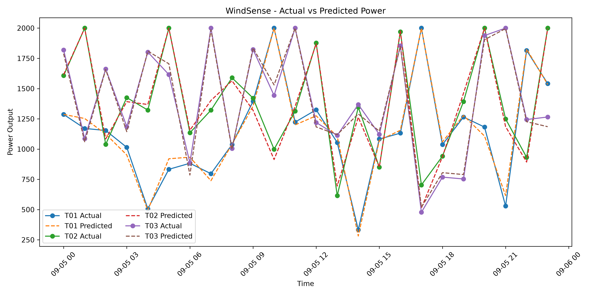
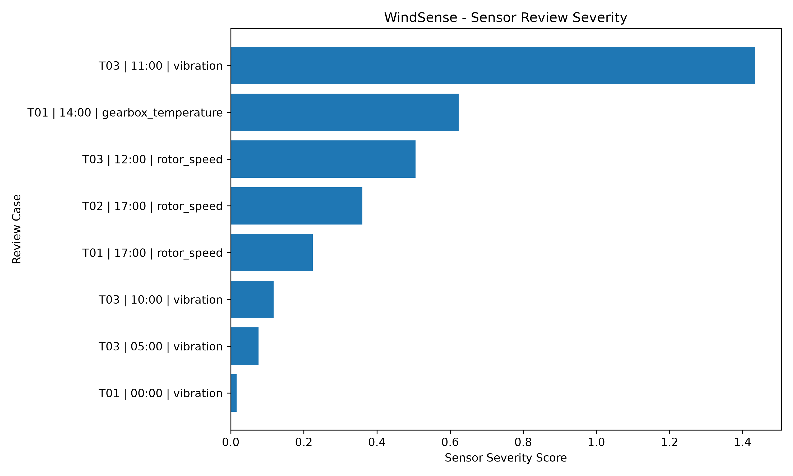

# WindSense

WindSense is a wind turbine performance monitoring project built with Python and machine learning.

The goal is to estimate how much power a turbine is expected to produce under current environmental conditions, compare that prediction with actual production, and identify unusual sensor behavior that may require further review.

The project uses a small synthetic wind turbine dataset and focuses on building a complete data science workflow rather than diagnosing real mechanical failures.

---

## Overview

WindSense follows two monitoring paths:

**Performance monitoring**
- predicts expected power output
- compares expected and actual production
- flags unusually large production shortfalls

**Sensor monitoring**
- checks vibration, rotor speed, and gearbox temperature
- compares each turbine with its own historical behavior
- considers the expected operating load: LOW, MEDIUM, or HIGH
- assigns a severity score to unusual sensor values

The final output combines both monitoring paths into a single review table.

---

## Pipeline

```text
Raw Data
   ↓
Data Cleaning
   ↓
Feature Engineering
   ↓
Model Training
   ↓
Time-Series Validation
   ↓
Expected Power Prediction
   ↓
Performance Monitoring
   +
Sensor Monitoring
   ↓
Review Cases
   ↓
CSV Reports + Visualizations

## Results

Three regression models were evaluated on the final test period:

| Model | MAE | RMSE | R² |
|---|---:|---:|---:|
| Linear Regression | 72.52 | 97.16 | 0.951 |
| Random Forest | 37.54 | 51.49 | 0.986 |
| Gradient Boosting | 38.36 | 50.75 | 0.987 |

Random Forest was selected based on expanding-window time-series validation.

During the final test period:

- Performance review cases: 0
- Sensor review cases: 8

The highest-severity sensor review case was observed for T03 at high load, where vibration exceeded its historical load-aware range.

Review cases represent statistical deviations and are not confirmed mechanical failures.

---

## Visualizations

### Actual vs Predicted Power



### Sensor Review Severity



---

## Run Locally

Install the required packages:

```bash
pip install -r requirements.txt